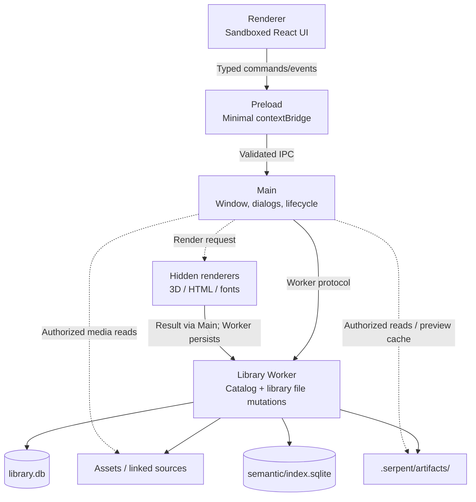

# Architecture

## Process model

```
Renderer (sandboxed, no Node)
  │ typed commands/events only
  ▼
Preload (minimal bridge, contextIsolation)
  ▼
Main (window + dialogs + process lifecycle)
  ▼
Library Worker (UtilityProcess; filesystem + SQLite owner)
```



Invariants:

- The Renderer never gets arbitrary path or SQL capabilities
- Main never opens the library database or scans asset directories
- The Library Worker owns library catalog databases and domain file mutations. Main performs authorized media reads, preview caching, application settings and plugin package I/O
- All cross-process I/O is validated with Zod at runtime

Main owns hidden renderers for 3D models, HTML and fonts. Rendered results return to the Worker for persistence; PDF thumbnails use the Worker path.

## Tech stack

Electron + TypeScript + SQLite (better-sqlite3, FTS5) + Vite + React. Packaging via electron-forge + Vite multi-entry (main / preload / offscreen / worker / script runtimes).

## Directory layout

```
src/
├── main/          # Electron main: windows, dialogs, lifecycle, custom protocols
├── preload/       # contextBridge
├── renderer/      # React renderer
├── worker/        # Library Worker: SQLite, filesystem, import/search/thumbnail pipelines
├── scripting/     # script runtime and plugin hosts
├── shared/        # cross-process: protocols, types, validation schemas
├── plugins/       # plugin manifests, SDK and contribution contracts
├── mcp/           # MCP tool catalog and call adapters
└── automation/    # shared automation Registry and Gateway
scripts/           # build, media, packaging, release scripts
resources/         # runtime resources (media binaries, ufbx WASM, icons)
tests/
├── unit/          # pure unit tests (Node ABI)
├── worker/        # worker integration tests (Electron ABI)
└── e2e/           # Playwright E2E (dev and packaged)
docs/              # documentation (this tree, ADRs, specs, QA)
```

## Data layer

- Library catalog metadata lives in `.serpent/library.db`. The supported schema version is derived from the last `MIGRATIONS` entry by `SUPPORTED_SCHEMA_VERSION` in `src/worker/library-service.ts`. The derived semantic index has a separate database at `.serpent/semantic/index.sqlite` and its own `SEMANTIC_SCHEMA_VERSION` in `src/worker/semantic-index-store.ts`
- Asset files live in `Assets/`; derived data (thumbnails/proxies) in `.serpent/artifacts/`
- The released animation v60 and upstream directory-index v60 histories converge transactionally on v61, preserving both SQL checksums and user data. See [v60 fork compatibility (Chinese)](schema-v60-compatibility.md) for recognition, rollback and acceptance coverage.
- **Data-compatibility discipline**: migrations are add-only (no dropping/renaming existing tables, columns, indexes or triggers); new builds must open old libraries (lenient reads — missing columns degrade to defaults, never crash); Desktop does not offer read-only libraries — damage is repaired from backups then Assets rescue. Library availability is the hardest baseline: any library-related change must fully run `npm run test:library-availability`. See [ADR-0028](../internal/adr/0028-schema-compatibility-read-only-degrade.md) and [0031](../internal/implementation/0031-schema-compatibility-guarantee.md)

## Media pipeline

- Image/audio/video derivatives: Worker queues → Worker decoders or media child processes (FFmpeg/OIIO) → Worker writes artifacts
- FBX: ufbx WASM conversion → GLB (cached) → rendered via GLTFLoader
- 3D / HTML / font thumbnails: Worker queues → Main hidden renderer → result returns to Worker → artifacts written

## Extension system

Plugins (sandboxed UI + Host API), automation scripts (isolated QuickJS), and MCP (Desktop-embedded loopback Streamable HTTP) — see the [extension author manual](../manual/README.md).

## Key design decisions

- Process isolation and least privilege: no Node in the Renderer, Main never touches the database
- Data compatibility is a release-level gate (Serpent-033e / ADR-0028 / 0031)
- Native-platform builds only (no cross-packaging); the release pipeline carries end-to-end gates

For requirement-specific entry points, related effects and tests, see the [code navigation map (Chinese)](architecture-code-map.zh-CN.md).
