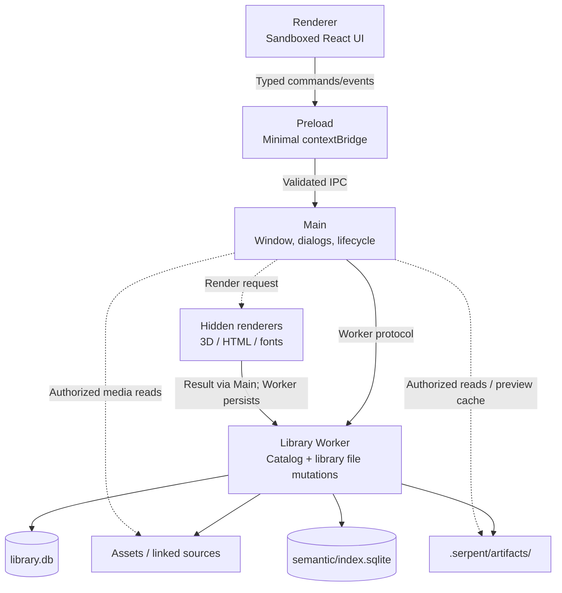

# 架构

## 进程模型

```
Renderer (sandboxed, no Node)
  │ typed commands/events only
  ▼
Preload (minimal bridge, contextIsolation)
  ▼
Main (window + dialogs + process lifecycle)
  ▼
Library Worker (UtilityProcess; filesystem + SQLite owner)
```



不变量：

- Renderer 永远不接收任意路径读写或 SQL 能力
- Main 不打开资源库数据库、不扫描资产目录
- Library Worker 负责资源库目录数据库及领域文件变更；Main 执行授权后的媒体读取、预览缓存、应用设置和插件包 I/O
- 所有跨进程 I/O 经 Zod 运行时校验

Main 持有用于 3D 模型、HTML 和字体的隐藏渲染页面；渲染结果返回 Worker 持久化。PDF 缩略图走 Worker 路径。

## 技术栈

Electron + TypeScript + SQLite（better-sqlite3，FTS5）+ Vite + React。构建用 electron-forge + Vite 多入口（main / preload / offscreen / worker / 脚本运行时）。

## 目录结构

```
src/
├── main/          # Electron 主进程：窗口、对话框、进程生命周期、自定义协议
├── preload/       # contextBridge 桥
├── renderer/      # React 渲染器
├── worker/        # Library Worker：SQLite、文件操作、导入/搜索/缩略图管线
├── scripting/     # 脚本运行时与插件 Host
├── shared/        # 跨进程共享：协议、类型、校验 schema
├── plugins/       # 插件 manifest、SDK 与贡献契约
├── mcp/           # MCP 工具目录与调用适配
└── automation/    # 共享自动化 Registry / Gateway
scripts/           # 构建、媒体、打包、发布脚本
resources/         # 运行时资源（媒体二进制、ufbx WASM、图标）
tests/
├── unit/          # 纯单元测试（Node ABI）
├── worker/        # Worker 集成测试（Electron ABI）
└── e2e/           # Playwright E2E（dev 与 packaged）
docs/              # 文档（本目录、ADR、实施规格、QA）
```

## 数据层

- 资源库目录元数据存于 `.serpent/library.db`。支持的 schema 版本由 `src/worker/library-service.ts` 中 `SUPPORTED_SCHEMA_VERSION` 取 `MIGRATIONS` 最后一项；派生语义索引另存于 `.serpent/semantic/index.sqlite`，独立版本见 `src/worker/semantic-index-store.ts` 的 `SEMANTIC_SCHEMA_VERSION`
- 资产文件存 `Assets/`，派生数据（缩略图/代理）存 `.serpent/artifacts/`
- **数据兼容纪律**：迁移只加不改（禁删改现有表/列/索引/触发器）；新代码必须能打开旧库（宽容读取：缺列降级默认值，不崩溃）；Desktop 不提供只读资源库，损坏走备份再 Assets 抢救。资源库可用性是项目最重要底线，相关改动必须完整跑完 `npm run test:library-availability`。见 [ADR-0028](../internal/adr/0028-schema-compatibility-read-only-degrade.md) 与 [0031](../internal/implementation/0031-schema-compatibility-guarantee.md)

## 媒体管线

- 图像/音频/视频派生物：Worker 排队 → Worker 解码器或媒体子进程处理（FFmpeg/OIIO）→ Worker 写回 artifacts
- FBX：ufbx WASM 转换 → GLB（缓存）→ GLTFLoader 渲染
- 3D / HTML / 字体缩略图：Worker 入队 → Main 隐藏页面渲染 → 结果返回 Worker → 写回 artifacts

## 扩展体系

- 插件（sandboxed UI + Host API）、自动化脚本（QuickJS 隔离）、MCP（Desktop 内嵌 loopback Streamable HTTP）——详见[扩展作者手册](../manual/README.md)

## 关键设计决策

- 进程隔离与最小权限：Renderer 无 Node、Main 不碰数据库
- 数据兼容为发布级门禁（Serpent-033e / ADR-0028 / 0031）
- 平台原生构建（无交叉打包），发布流水线带全链路门禁

按具体需求查源码入口、关联影响和测试，见[需求代码导航](architecture-code-map.zh-CN.md)。

## 动画资产

Aseprite 动画包由核心 Worker 托管，源资产与唯一 GIF 通过稳定 asset ID 关联；预览配置和生成记录随库保存。Codex 项目 Skill 负责制作与主动更新，Serpent 负责单卡片展示、GIF 播放及外部源文件打开。预览发布使用源版本和内容摘要围栏，旧预览保留到新结果成功提交。接口、迁移和恢复见[动画资产](animation-assets.md)。
